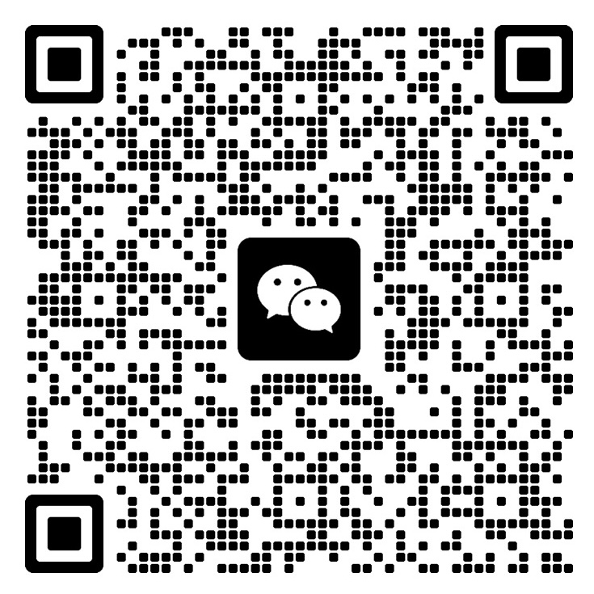

  

<h1 align="center">DooJank · 渡江客</h1>

Notes from the crossing. Philosophy, attention, and everyday life.

<a href="https://lumisum.github.io/doojank/">Read the journal ↗</a> · <a href="https://lumisum.github.io/doojank/zh/">中文阅读 ↗</a>

---

## About this journal

DooJank takes its name from 渡江客—a traveler crossing a river. I write from everyday experience, using philosophy to see familiar things more carefully. These essays hold observations and judgments that remain open to revision.

渡江客，是渡江的客人。这里留下关于人生、专注与变化的个人手记，在真实的日常里，慢慢看清自己与世界的关系。

WeChat publication「无来」 · Buddhist study group

---

## 经典阅读

佛典与心学原文，附无来的白话学习笔记。可只读原文，也可逐段对照。

<table>
  <tr>
    <td width="50%" align="center"><a href="https://lumisum.github.io/doojank/classics/diamond-sutra/"><strong>金刚般若波罗蜜经</strong></a></td>
    <td width="50%" align="center"><a href="https://lumisum.github.io/doojank/classics/heart-sutra/"><strong>般若波罗蜜多心经</strong></a></td>
  </tr>
  <tr>
    <td width="50%" align="center"><a href="https://lumisum.github.io/doojank/classics/platform-sutra/"><strong>六祖坛经</strong></a></td>
    <td width="50%" align="center"><a href="https://lumisum.github.io/doojank/classics/chuanxilu/"><strong>传习录</strong></a></td>
  </tr>
</table>

[进入经典阅读目录 ↗](https://lumisum.github.io/doojank/classics/)

---

## 内容重构中 · Journal rebuild

所有已发布文章已从网站下架，正在重新构建内容体系。四部经典仍可阅读。

All previously published essays have been taken offline while the journal is being rebuilt. The reading shelf remains available.

文章原稿、中英文版本、平台 HTML 和图片保留在仓库中，供后续整理使用。
